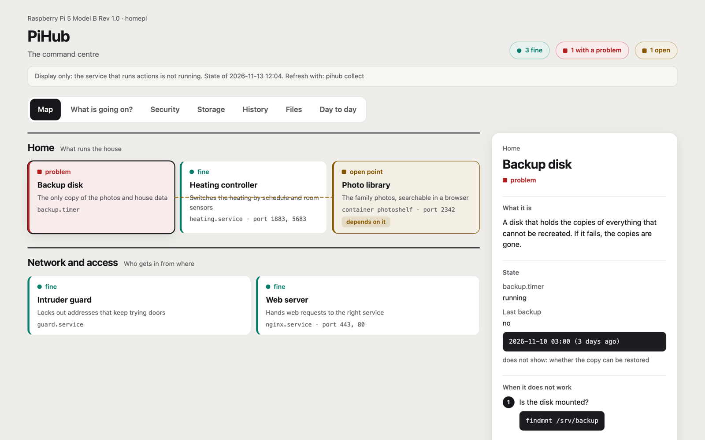
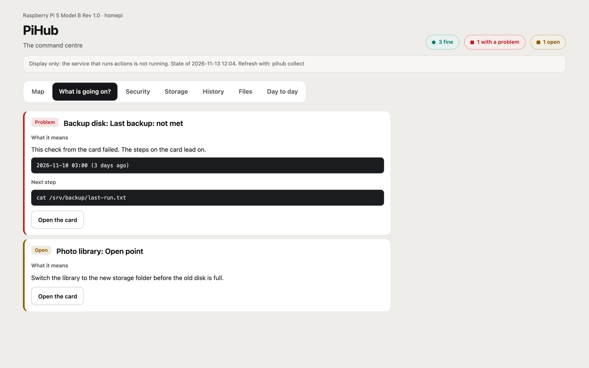
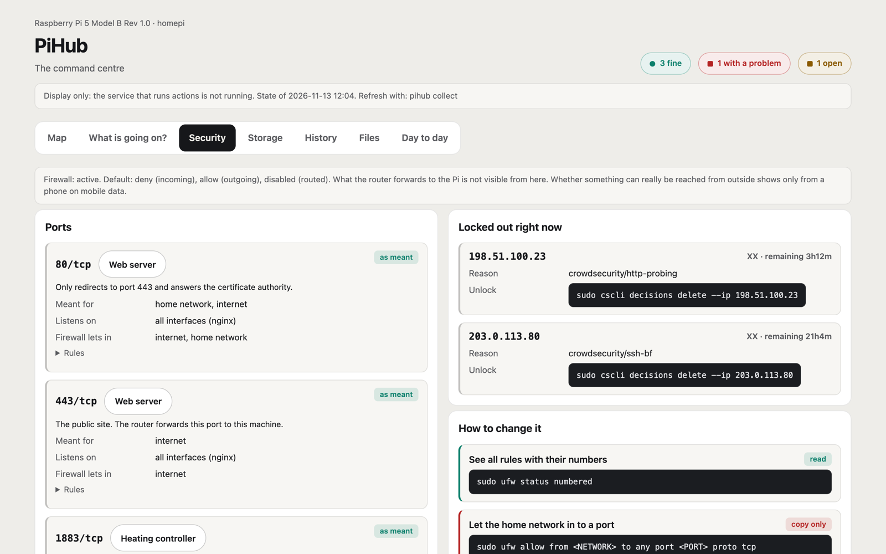
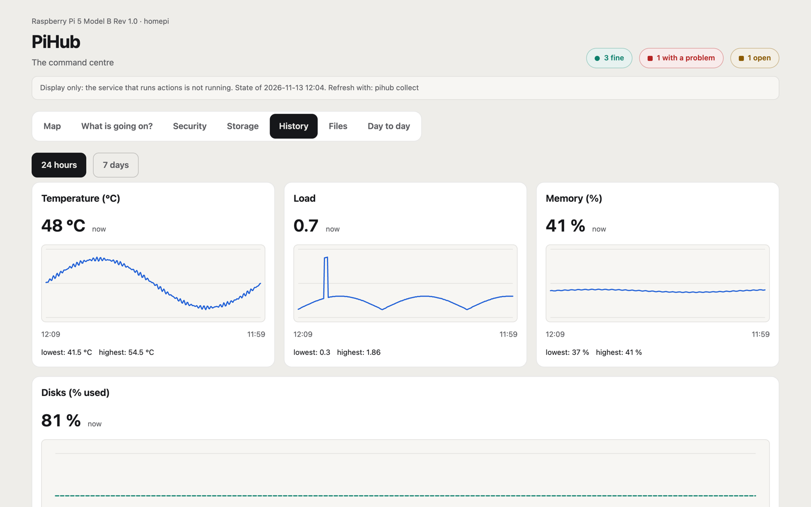

<div align="center">

# PiHub

**A command centre for a Raspberry Pi home server that explains itself.**

[](https://github.com/Auktoriator/PiHub/actions/workflows/test.yml)
[](https://github.com/Auktoriator/PiHub/releases)


[](LICENSE)

<picture>
  <source media="(prefers-color-scheme: dark)" srcset="docs/images/map-dark.png">
  
</picture>

</div>

You own a small home server. It runs a web server, a backup, a few
containers, and you set most of it up months ago. PiHub tells you, in plain
words, what runs there, what is wrong right now, what that means and what to
do next. And it keeps working on the day no AI assistant is at hand.

- **See it all at once.** Every service on one map, green, red or yellow, with lines for what depends on what.
- **Understand what is wrong.** Each finding says what it means and the next command to run.
- **Know who gets in.** Every open port next to who it is meant for and what the firewall really lets in.
- **Act safely.** Run the commands written on the cards from the page, behind a password and a question that names the consequences.

## A look inside

| What is going on? | Security | History |
|:---:|:---:|:---:|
| [](docs/images/findings.png) | [](docs/images/security.png) | [](docs/images/history.png) |
| Findings, what they mean, what to do | Ports, firewall, locked-out addresses | Temperature, load, memory, disks |

The screenshots use the [example cards](examples/) on an invented machine.
The page works on a phone, in light and dark mode.

## Get started

On the Pi itself, in [Claude Code](https://claude.com/claude-code):

```
claude plugin marketplace add Auktoriator/PiHub
claude plugin install pihub@pihub
/pihub:setup
```

Claude Code looks at what is there, asks you what is unclear, writes one card
per service, lets you review every command that could ever be run, and only
sets up the services after your explicit yes. You choose the password
yourself. Later, `/pihub:update` brings in new versions and describes new
services.

No Claude Code? See [Without Claude Code](#without-claude-code).

---

## How it works

| Step | Who | What |
|---|---|---|
| Scan | scripts, no AI | read units, timers, containers, ports, firewall, blocked addresses, disks and web sites into an inventory |
| Understand | Claude Code, once | write one card per service: plain-language name, what it needs, intended ports, checks, steps for when it fails, allowed commands |
| Run | a small service, no AI | show the map, run the checks, run allowed commands |

The scan says what is there. The cards say what it means. Where the two
disagree, that disagreement is the finding: a service nobody described, or a
port that should serve the home network and only listens on the machine
itself.

The page has seven views: **Map**, **What is going on?**, **Security**,
**Storage** (what should be mounted and what is), **History** (24 hours or 7
days), **Files** (the places that matter and everyday file commands) and
**Day to day** (links to all pages and the commands by area).

Logged in, you can run the actions written on the cards: `read` at once,
`change` after a question that names the consequences, `copy` never (it is
only shown, to copy into a terminal).

## Security, honestly

- The web page runs nothing. It passes requests on to a separate process, the
  runner, which checks the password and runs only commands written on the
  cards, read from disk by the runner itself.
- Cards are code. Whoever can write to the data folder can make the runner
  run commands as its user. Review every action (Claude Code does this with
  you during setup).
- There is no HTTPS. Run PiHub on the home network only, restrict the port in
  the firewall to your own network, and never forward it on the router.
- Viewing the page needs no login. Only actions do.
- Your inventory and cards describe your machine. They live in `~/pihub-data`,
  not in this repository.

The scan is written so that no credential can reach the inventory: it does
not call `docker inspect`, records process names but no command lines, and
reads no file contents apart from a fixed set of nginx directives and the
mount points in `/etc/fstab`.

More in [SECURITY.md](SECURITY.md), including how to report a vulnerability.

## Requirements and limits

- Linux with systemd, Python 3.11 or newer, standard library only. Nothing to
  install for the program itself.
- The scan covers systemd, Docker, ufw, CrowdSec and nginx. Whatever is not
  installed is skipped. Some sections need `sudo` without a password prompt
  (firewall, blocked addresses) and are skipped without it.
- **So far PiHub has been run on exactly one machine: a Raspberry Pi 5 with
  Debian 13.** Other setups are untested; expect rough edges.

## Without Claude Code

The cards are plain TOML files. Copy [examples/](examples/) to
`~/pihub-data`, write your own following [docs/card-format.md](docs/card-format.md)
and [docs/writing-cards.md](docs/writing-cards.md), and run
`bin/pihub check`. To run it all the time, see
[systemd/README.md](systemd/README.md). Clone the repository to `~/PiHub`
(the unit files expect the program there, but that can be changed).

<details>
<summary><b>Command line</b></summary>

```
bin/pihub scan         read the machine, write the inventory (changes nothing)
bin/pihub check        check the cards and compare them with the inventory
bin/pihub collect      scan, run the checks on the cards, write the current state
bin/pihub serve        the web page on http://127.0.0.1:8096
bin/pihub password     set the password for actions (asks twice in a terminal)
bin/pihub runner       the second process that checks the password and runs actions
bin/pihub list         all cards by area
bin/pihub show <id>    one card: what it is, checks, steps, commands
```

`--data <folder>` (or `$PIHUB_DATA`) chooses the data folder; the default is
`~/pihub-data`. The language is `language = "de"` or `"en"` in
`<data>/settings.toml`. `collect` runs only the commands listed under
`checks` on the cards.

</details>

## Documents

- [Card format](docs/card-format.md)
- [Writing cards](docs/writing-cards.md): style guide and safety rules
- [Running PiHub as a service](systemd/README.md)
- [Konzept](docs/konzept.md) (German): the idea, the pages, the stages
- [Security](SECURITY.md)

## Licence

MIT, see [LICENSE](LICENSE).
